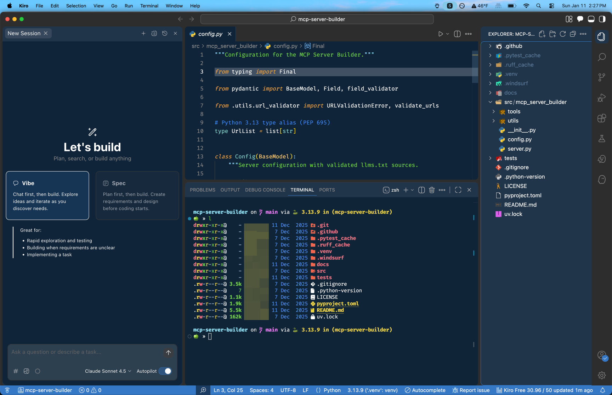
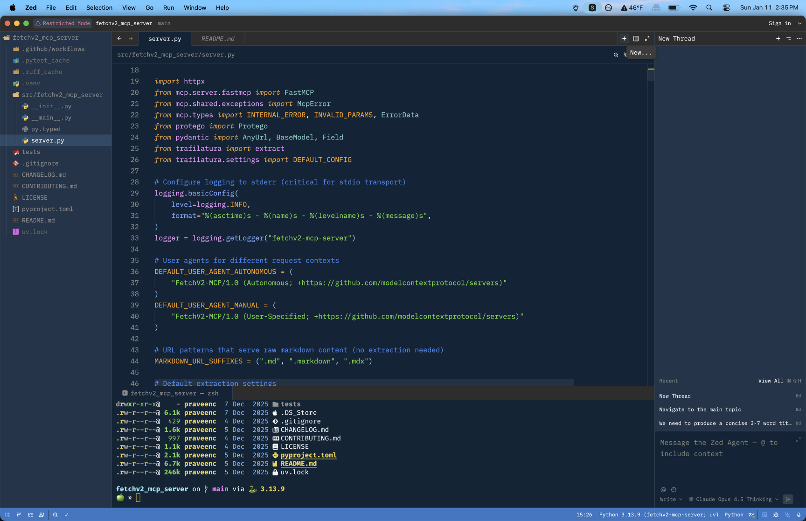
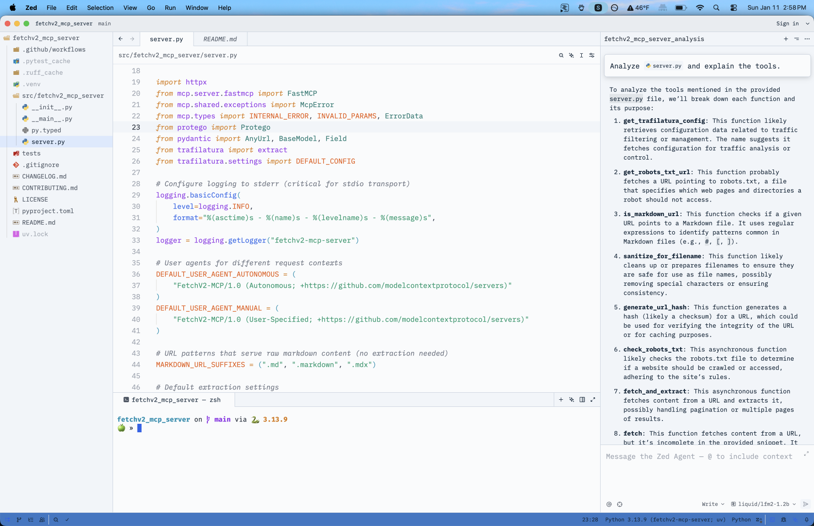
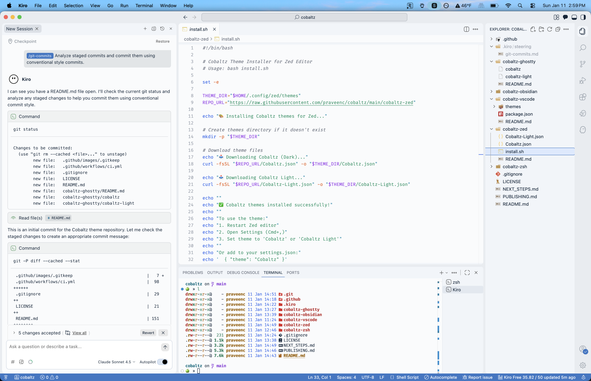
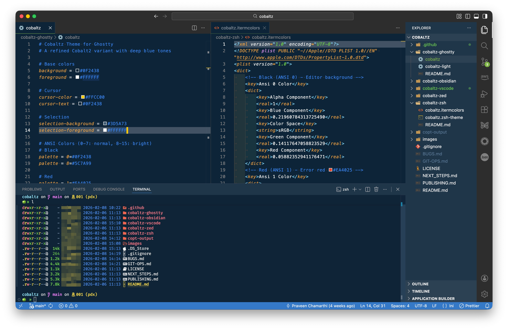
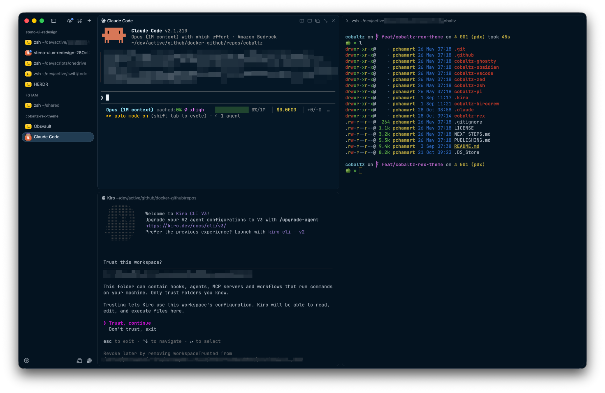
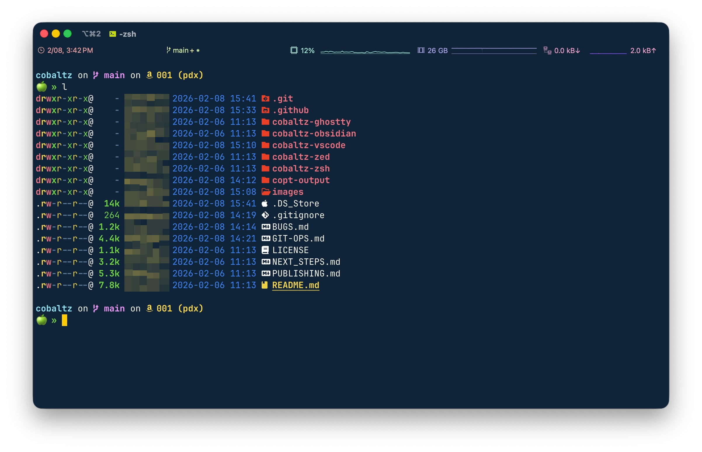

# Cobaltz

A refined take on [Cobalt2](https://github.com/wesbos/cobalt2-vscode): deep cobalt blues, vivid syntax colors, and a signature golden cursor. Dark and light variants for editors, terminals, and coding agents.



## Highlights

- Deep cobalt background (`#0F2438`) that stays easy on the eyes through long sessions
- Vivid, balanced syntax colors that stay readable in both variants
- Signature golden cursor (`#FFCC00`) and blue status bar accent (`#3478C6`)
- Platform-tuned variants where an app derives its own UI from the palette, such as Rex

## Platforms

| Platform | Dark | Light | Install |
| -------- | :--: | :---: | ------- |
| [Zed](https://zed.dev) | ✅ | ✅ | [Zed](#zed) |
| [VS Code](https://code.visualstudio.com), Cursor, Windsurf, Kiro | ✅ | ✅ | [VS Code](#vs-code) |
| [KiroCrew](./cobaltz-kirocrew/) | ✅ | ✅ | [KiroCrew](#kirocrew) |
| [Obsidian](https://obsidian.md) | ✅ | ✅ | [Obsidian](#obsidian) |
| [Ghostty](https://ghostty.org) | ✅ | ✅ | [Ghostty](#ghostty) |
| [Rex](https://rex.superlogical.com) by Superlogical | ✅ | ✅ | [Rex](#rex) |
| [iTerm2](https://iterm2.com) + Oh My Zsh | ✅ | - | [iTerm2 / Zsh](#iterm2--zsh) |
| [Pi Coding Agent](https://github.com/earendil-works/pi) | ✅ | - | [Pi](#pi-coding-agent) |

## Screenshots

### Editors

| | Dark | Light |
| - | ---- | ----- |
| **Zed** |  |  |
| **Kiro** |  |  |
| **VS Code** |  | |

### Terminals

| Rex | iTerm2 |
| --- | ------ |
|  |  |

## Color Palette

| Element | Dark | Light |
| ------- | ---- | ----- |
| Background |  |  |
| Foreground |  |  |
| Cursor |  |  |
| Keywords |  |  |
| Functions |  |  |
| Strings |  |  |
| Variables |  |  |
| Comments |  |  |
| Types |  |  |
| Numbers |  |  |

## Installation

Clone the repository first; every option below uses files from your clone.

```bash
git clone https://github.com/praveenc/cobaltz.git
cd cobaltz
```

### Zed

1. Copy `cobaltz-zed/Cobaltz.json` and `cobaltz-zed/Cobaltz-Light.json` to `~/.config/zed/themes/`.
2. In Zed, select **Cobaltz** or **Cobaltz Light** from the theme picker.

See [`cobaltz-zed/README.md`](cobaltz-zed/README.md) for the install script.

### VS Code

Works with VS Code forks such as Cursor, Windsurf, and Kiro.

- **From VSIX:** run `npx vsce package` in `cobaltz-vscode/`, then run **Extensions: Install from VSIX…** in VS Code and select the generated file.
- **Manual:** copy the `cobaltz-vscode` folder to `~/.vscode/extensions/cobaltz-theme` (macOS and Linux) or `%USERPROFILE%\.vscode\extensions\cobaltz-theme` (Windows).

Then select **Cobaltz** or **Cobaltz Light** under **Preferences: Color Theme**.

### KiroCrew

1. In KiroCrew, open **Settings → Display → Install theme**.
2. Select the `cobaltz-kirocrew` folder.
3. Select **Cobaltz** from the theme picker. KiroCrew switches palettes with your dark or light appearance.

See [`cobaltz-kirocrew/README.md`](cobaltz-kirocrew/README.md) for pack details and updates.

### Obsidian

1. Copy the `cobaltz-obsidian` folder to your vault's `.obsidian/themes/` directory and rename it to `Cobaltz`.
2. Open **Settings → Appearance → Themes** and select **Cobaltz**.

The theme follows your system's dark or light appearance.

### Ghostty

```bash
mkdir -p ~/.config/ghostty/themes
cp cobaltz-ghostty/cobaltz cobaltz-ghostty/cobaltz-light ~/.config/ghostty/themes/
```

Then add this line to `~/.config/ghostty/config`:

```text
theme = dark:cobaltz,light:cobaltz-light
```

See [`cobaltz-ghostty/README.md`](cobaltz-ghostty/README.md) for transparency settings.

### Rex

[Rex](https://rex.superlogical.com) builds its window chrome from the theme colors, so it gets its own tuned variants with clear pane borders and a distinct active pane.

1. In Rex, open the command palette and run **Import Theme File**.
2. Select `cobaltz-rex/Cobaltz-Dark`, then repeat for `cobaltz-rex/Cobaltz-Light`.
3. Run **Change Theme…** and select **Cobaltz-Dark** for dark appearance and **Cobaltz-Light** for light appearance.

See [`cobaltz-rex/README.md`](cobaltz-rex/README.md) for what changes from the Ghostty colors and why.

### iTerm2 / Zsh

1. In iTerm2, open **Settings → Profiles → Colors → Color Presets → Import** and select `cobaltz-zsh/cobaltz.itermcolors`.
2. Copy the prompt theme and set `ZSH_THEME="cobaltz"` in `~/.zshrc`:

   ```bash
   cp cobaltz-zsh/cobaltz.zsh-theme ~/.oh-my-zsh/themes/
   ```

3. Use a [Powerline-patched font](https://github.com/powerline/fonts), or turn on **Use built-in Powerline glyphs** in iTerm2.

### Pi Coding Agent

Link the theme into Pi's themes directory:

```bash
mkdir -p ~/.pi/agent/themes
ln -s "$(pwd)/cobaltz-pi/cobaltz.json" ~/.pi/agent/themes/cobaltz.json
```

Then set `"theme": "cobaltz"` in `~/.pi/agent/settings.json`, or launch once with `pi --theme ./cobaltz-pi/cobaltz.json`.

## Contributing

Issues and pull requests are welcome, especially for new platforms. Each platform lives in its own `cobaltz-<platform>/` folder with a README.

## Credits

- Inspired by [Cobalt2](https://github.com/wesbos/cobalt2-vscode) by Wes Bos
- Created by Praveen Chamarthi ([@praveenc](https://github.com/praveenc))

## License

MIT. See [LICENSE](LICENSE).
