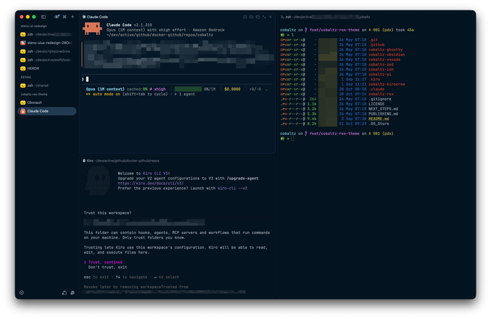
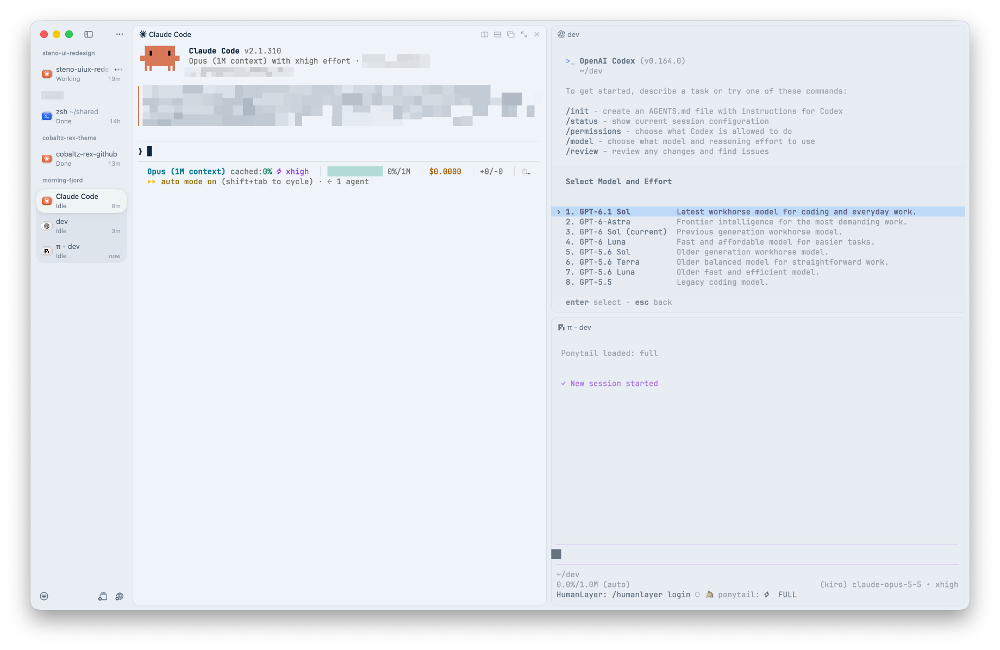

# Cobaltz Theme for Rex

Cobaltz tuned for [Rex](https://rex.superlogical.com), the terminal multiplexer by Superlogical. It keeps the Cobaltz hues, syntax accents, and cursor colors, and adjusts the base colors so Rex's pane borders, active-pane highlight, and selected tab stay distinct when several panes are open.

| Dark | Light |
| ---- | ----- |
|  |  |

## Files

- `Cobaltz-Dark` - Dark theme
- `Cobaltz-Light` - Light theme

## Installation

1. Clone or download this repository.
2. In Rex, open the command palette and run **Import Theme File**.
3. Select `cobaltz-rex/Cobaltz-Dark`, then repeat for `cobaltz-rex/Cobaltz-Light`.
4. Run **Change Theme…** and select **Cobaltz-Dark** for dark appearance and **Cobaltz-Light** for light appearance.

Rex copies the colors when it imports a file. To pick up changes after pulling or editing the repository, import the file again.

## Why a Rex-specific variant

Rex builds its window chrome from the theme's base colors, so the [Ghostty themes](../cobaltz-ghostty/) don't carry over cleanly.

### Dark

Pane borders are fixed white overlays (7% for inactive panes, 10% for the active pane), and sidebars and raised surfaces step up in lightness from the background. Those values are tuned for the deep backgrounds of Rex's built-in dark themes. The Ghostty background (`#0F2438`) is brighter than any of them, so the same overlay adds less relative contrast and pane borders read faintly.

| Element | Ghostty | Rex | Reason |
| ------- | ------- | --- | ------ |
| Background | `#0F2438` | `#051626` | Same cobalt hue at the depth of Rex's built-in dark themes, so pane borders read clearly |
| Foreground | `#FFFFFF` | `#E7EEF5` | Cool soft white in the range Rex's built-in themes use, with less glare across many panes |
| Selection | `#3D5A73` | `#183B5C` | Saturated cobalt one step above the canvas |
| Black (ANSI 0) | `#0F2438` | `#0F2438` | Now sits one step above the background instead of matching it |

### Light

Rex fills the active pane and the selected tab with surfaces lifted toward white from the background. The Ghostty background (`#FAFBFC`) is already almost white, so there is no room for that lift: the active pane, inactive panes, and sidebar all render as the same white.

| Element | Ghostty | Rex | Reason |
| ------- | ------- | --- | ------ |
| Background | `#FAFBFC` | `#EFF4FA` | Cool cobalt tint just below white, matching the depth of Rex's built-in light themes, so the active pane and selected tab lift visibly |
| Selection | `#DBEAFE` | `#C4DCF7` | Deeper blue so selections stand out against the tinted background |
| White (ANSI 7) | `#F9FAFB` | `#CBD5E1` | Light gray that stays visible on the background |

Cursor colors and every other ANSI color are unchanged in both variants. Rex uses the cursor color as its accent, so the focus highlight is Cobaltz gold in dark and Cobaltz blue in light.

## Color Palette

| Element    | Dark      | Light     |
| ---------- | --------- | --------- |
| Background | `#051626` | `#EFF4FA` |
| Foreground | `#E7EEF5` | `#0F2438` |
| Cursor     | `#FFCC00` | `#2563EB` |
| Selection  | `#183B5C` | `#C4DCF7` |
| Red        | `#EA4025` | `#DC2626` |
| Green      | `#70D149` | `#059669` |
| Yellow     | `#ECD146` | `#D97706` |
| Blue       | `#3B86F7` | `#2563EB` |
| Magenta    | `#EE7FF8` | `#9333EA` |
| Cyan       | `#95E5F8` | `#0891B2` |

## Author

Praveen Chamarthi - [@praveenc](https://github.com/praveenc)

## License

MIT - see [LICENSE](../LICENSE)
